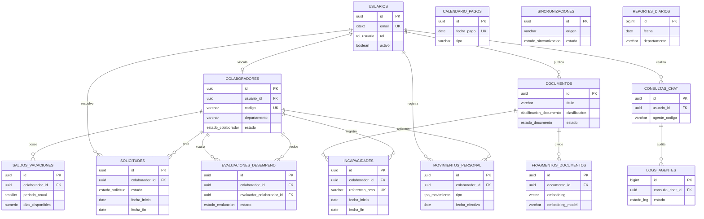

# Diagrama entidad-relación — NexoTico

## Nota de modelado

El documento académico con un catálogo de campos no estaba disponible en el repositorio al crear este esquema. Los campos implementados se derivan de las políticas aprobadas y del objetivo de indicadores; deben compararse con ese documento antes de una migración productiva.

