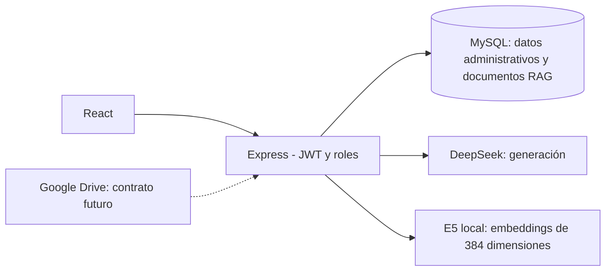
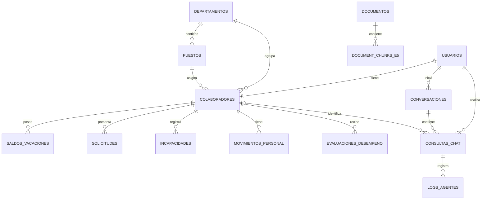

# Arquitectura de almacenamiento y relaciones

La relación `documentos` → `document_chunks_e5` se implementa mediante una clave foránea en MySQL. La tabla anterior se conserva separada y no participa en las búsquedas actuales.

Cada conversación pertenece a un usuario. Las consultas de historial filtran por el usuario autenticado, y una clave de idempotencia única por usuario evita duplicar el registro cuando se reintenta la misma petición. `colaborador_id` es nullable para conservar consultas históricas creadas antes de la asociación al perfil.
