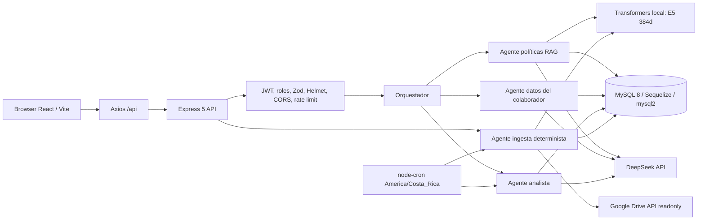
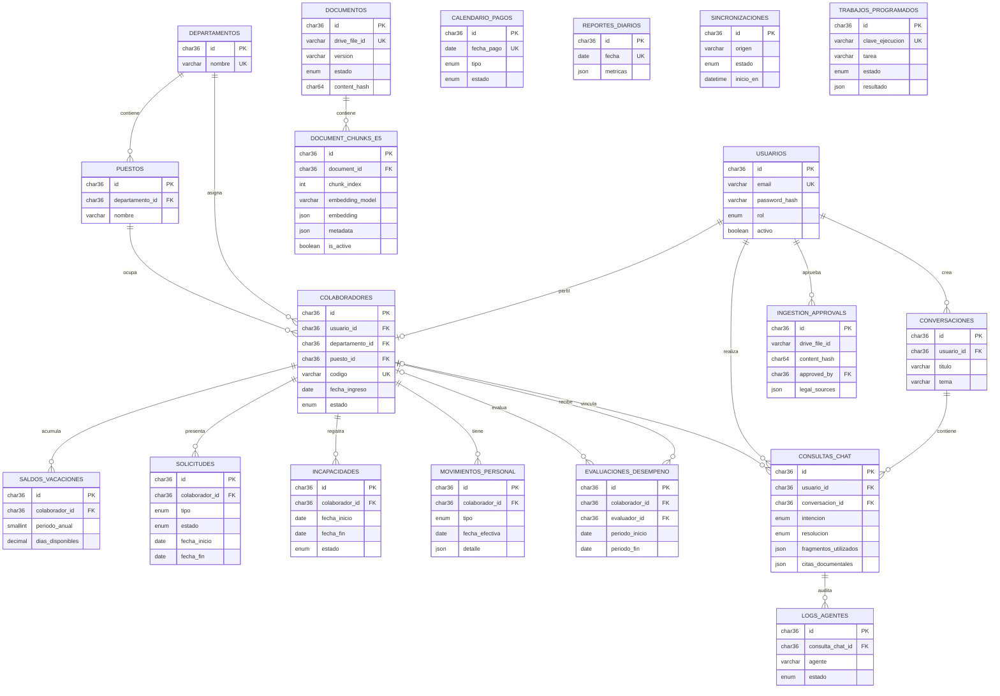
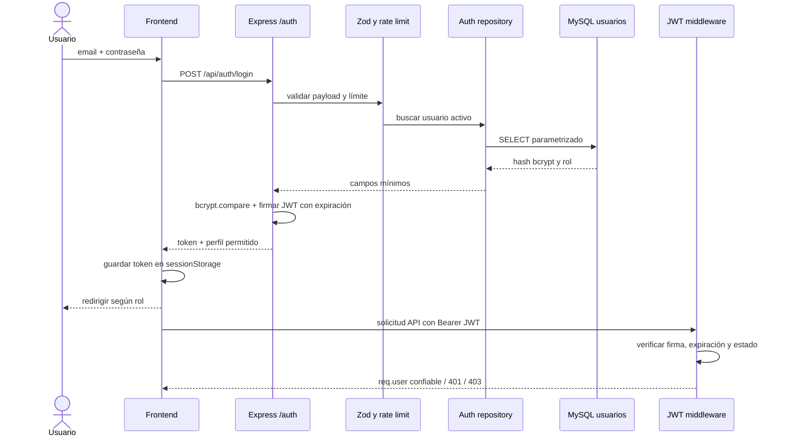
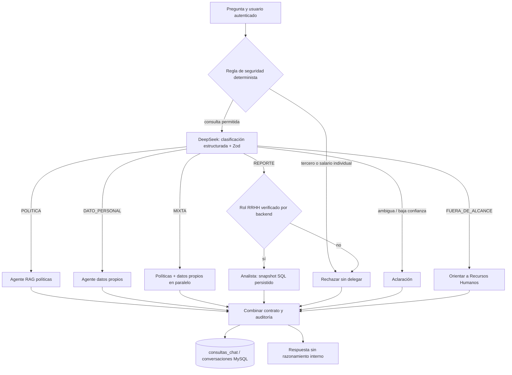
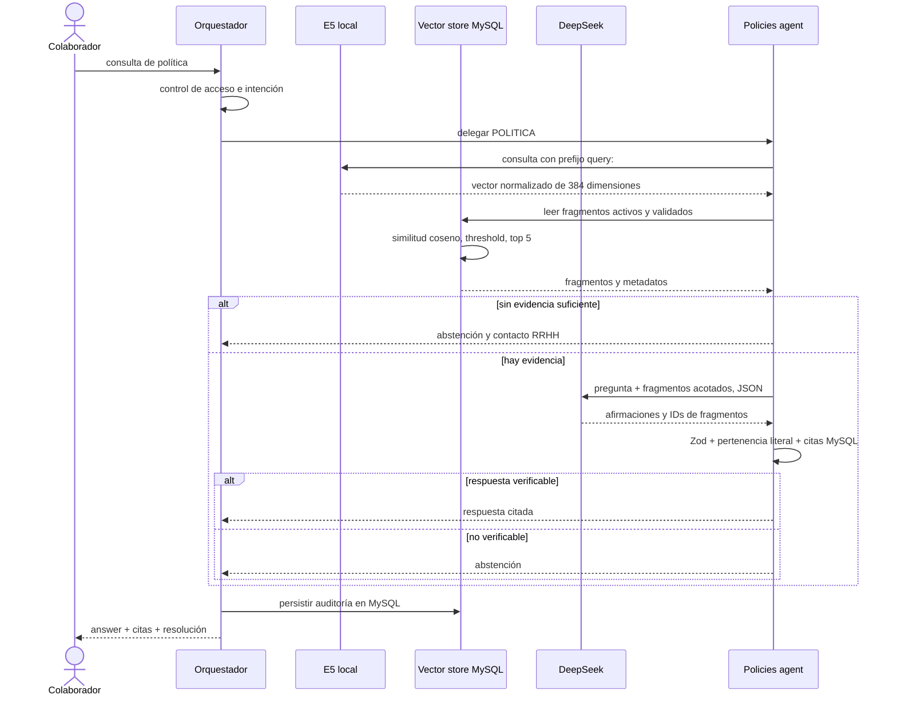
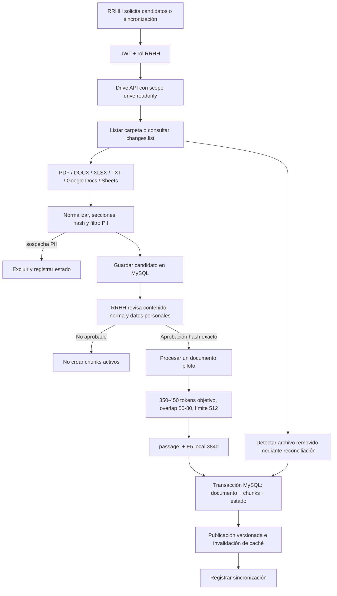

# Diagramas del sistema

Los diagramas representan la arquitectura y flujos inspeccionados en el repositorio al 18/11/2026. Las integraciones externas se dibujan aunque su disponibilidad real estuviera bloqueada durante la última evaluación. Los agentes se implementan bajo `backend/src/services/`.

## 1. Arquitectura general



## 2. Entidad-relación MySQL



El ER resume las tablas del SQL base y migraciones. `drive_ingestion_state` y `vector_cache_state` son tablas de control y no se incluyen como entidades de negocio. Las versiones antiguas de `document_chunks` no participan en la recuperación activa E5.

## 3. Flujo de autenticación



## 4. Arquitectura multiagente



## 5. Pipeline RAG



## 6. Ingesta de Google Drive



## 7. Generación del reporte diario

```mermaid
sequenceDiagram
  participant C as node-cron
  participant J as Scheduler
  participant I as Ingestion agent
  participant A as Analyst agent
  participant R as Report repository
  participant DB as MySQL
  participant DS as DeepSeek
  Note over C,J: America/Costa_Rica, proceso Node activo
  C->>J: 06:00
  J->>J: reclamar clave única drive-sync:fecha
  J->>I: sincronizar Drive
  I->>DB: registrar estado
  C->>J: 07:00
  J->>J: reclamar clave única daily-report:fecha
  J->>A: generar solo si no existe snapshot
  A->>R: métricas con SQL agregada parametrizada
  R->>DB: lectura de datos
  DB-->>R: filas agregadas
  R-->>A: métricas
  A->>DS: cifras y frases permitidas (solo resumen)
  DS-->>A: referencias a frases
  A->>A: validar; usar fallback SQL si falla
  A->>DB: insertar reportes_diarios por fecha única
  J->>DB: completar trabajos_programados
  Note over J,DB: Al iniciar, recupera tareas faltantes sin duplicar
```

## Referencias de implementación

- Composición de Express: `backend/src/app.js`; arranque y scheduler: `backend/src/server.js`.
- Esquema: `database/mysql/schema.sql` y `backend/migrations/`.
- Recuperación: `backend/src/services/vector-store.service.js` y `policies.agent.js`.
- Clasificación y ruta: `backend/src/services/orchestrator.agent.js`.
- Ingesta y cron: `backend/src/services/ingestion.agent.js`, `backend/src/jobs/scheduler.js`.
- Métricas y snapshots: `backend/src/services/analyst.agent.js`, `backend/src/repositories/reportRepository.js`.
